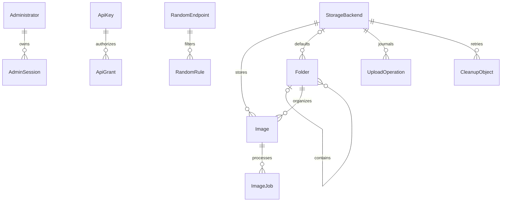
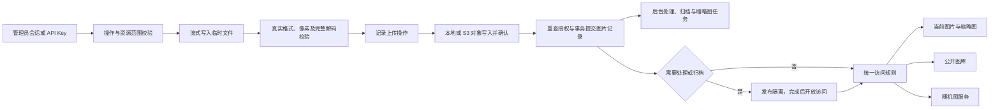

# 架构与实现

[文档首页](README.md) · [API 参考](api.md) · [部署与运维](operations.md)

[系统边界](#系统边界) · [工程与模块边界](#工程与模块边界) · [数据关系](#数据关系) · [权限与数据流](#权限与数据流) · [可靠性](#可靠性) · [上传、处理与归档管线](#上传处理与归档管线) · [存储迁移](#存储迁移) · [页面与接口](#页面与接口)

## 系统边界

XHImg 是独立的单管理员系统，包含授权上传、文件夹管理、本地与 S3 存储、公开图库、随机图 API、图片处理、断点续传、AI 归档和存储迁移。不提供匿名上传、公开注册或多租户。

P0、P1、P2 是历史开发阶段名称，分别对应基础图片管理、处理与续传及 AI、存储迁移。

第三方功能参考与源码来源声明见 [THIRD_PARTY_NOTICES.md](../THIRD_PARTY_NOTICES.md)。

## 工程与模块边界

```text
XHImg/
  apps/server/
    migrations/init.sql  SQLite 初始化结构
    src/
      app.ts          插件、安全钩子、路由装配与生命周期
      db.ts           SQLite/Drizzle、初始化和事务
      security.ts     密码、加密、签名、范围判定和限流
      auth.ts         安装、管理员会话、API Key
      resources.ts    文件夹、图片管理、存储设置和公共查询
      uploads.ts      流式上传和授权图片传输
      storage.ts      本地/S3 统一对象接口
      random.ts       来源规则、候选集合和三种响应
      pipeline.ts     上传校验、存储与提交管线
      policies.ts     处理策略、输入校验与 CPU 串行门
      processing.ts   图片重新处理及版本切换
      resumable.ts    续传协议、分片验证与偏移恢复
      organization.ts AI 调用、分类与人工归档
      migrations.ts   存储迁移预览与控制接口
      migration-worker.ts 复制、校验、切换与清理
      image-urls.ts   逻辑地址、S3 签发与有效期
      local-directories.ts 本地空目录回收
      jobs.ts         缩略图、彻底删除和残留清理
      openapi.ts      外部接口输入与错误契约
    test/             真实数据库/对象测试、S3 HTTP 夹具、规模检查
  apps/web/src/       React 页面、Radix 组件、主题和 API 客户端
  packages/shared/    前后端共用接口类型
  tests/              隔离服务器与 Playwright 用户流程
  docs/               架构、API、运维与验证记录
```

后端单进程提供 API 和编译后的页面，部署为单容器。不引入 Redis，不允许多个实例共享数据目录。SQLite 使用 WAL、外键、事务和索引；Drizzle 管理设置查询，复杂树关系及资源权限使用参数化 SQL。

## 数据关系



`sessions` 对应单一管理员，会话只存 token 摘要。`settings` 保存站点配置、加密 AI 配置和未安装时的令牌摘要。随机服务的 calls/successes/failures/last_called 保存基本统计，不引入逐请求分析表。`upload_sessions` 持久化续传与管线状态，`jobs.payload` 保存处理策略、版本及归属快照。

存储迁移使用 `storage_migrations`、`migration_items` 和 `migration_objects` 保存冻结清单、进度、版本快照、目标位置与源副本引用。上图展示主要基础关系，不是完整数据库表清单。

`random_endpoints.slug` 为可空、唯一的调用别名，全站、文件夹及自定义服务均可配置。`/api/v1/random/{serviceId}` 可按 ID 或 slug 定位同一服务；鉴权、候选缓存、限流、统计及签名仍绑定服务 ID。返回的服务 `url` 优先使用 slug，原调用地址继续有效；别名修改或清除不保留旧别名重定向。

## 权限与数据流



- 新建资源默认私有。任意祖先私有，图片最终私有；自身权限不会被文件夹修改覆盖。
- 文件夹移动防循环；权限变化、移动、删除恢复均更新有效权限与访问版本，失效候选缓存。
- API 操作权限与多条资源范围共同生效，文件夹默认不含后代。私有读取需 read、private:read 和来源文件夹授权。
- 原图、缩略图、列表和随机图共享判权。公开服务始终只选公开资源，并按服务配置筛选媒体类型。服务 ID 仅用于定位服务。
- 私有签名限定资源、原图/缩略图、权限版本、签发者与可选服务，默认五分钟；每次读取重新验证当前会话/Key、权限与来源。
- 本地图片与随机 `image` 模式通过后端传输。S3 图片经当前鉴权签发最长 5 分钟的 GET 预签名地址；旧 `/i/`、`/t/` 返回 302 且不缓存跳转，S3 响应覆盖为 private,no-store。临时地址不持久化；签发前后复核身份、权限和对象位置，不给仅上传的密钥额外读取权限。已签发 S3 能力链接不再经过站内鉴权，因此权限或密钥变更不保证立即撤销；长期引用使用站内逻辑地址。本地公开图片仍 no-cache，私有及随机响应 no-store，授权先于 304 条件处理。

- 本地和 S3 的 MP4 均通过 `/i/{id}` 提供单段 Range 播放。每次读取重新判权，S3 按请求读取对应字节。视频封面沿用缩略图传输。

随机候选从已过滤的数据库 ID 集合均匀选择，缓存按实际筛选的媒体类型隔离，不超过 16MiB 估算容量、20 个集合。返回前重新授权。允许连续重复，缺失对象最多尝试三个候选，供应商故障直接返回 503。

## 可靠性

上传对象写入与数据库提交用持久化操作记录衔接，异常退出恢复 abandoned 操作并回收孤立对象。缩略图失败不丢失原图，任务恢复 running 状态，最多五次自动重试。彻底删除先标记 purging，删除实际对象后才删记录。连接配置仍被图片或未完成操作引用时禁止更换。

上传每次一个文件，浏览器最多两个文件并发，默认 100 MiB / 4000 万像素。支持静态 JPG、PNG、WebP，以及静态和动态 GIF。GIF 上限为 500 帧和 4000 万总画布像素，校验时完整解码后原样保存。处理与缩略图共享 CPU 串行门，缩略图最长边 640px，不放大。处理默认关闭，适用于静态 JPG、PNG 和 WebP。GIF 缩略图与 AI 预览使用首帧。

## 上传、处理与归档管线

`pipeline.ts` 为 multipart 与续传统一执行校验、存储和数据库提交。`policies.ts` 逐字段解析策略并串行图片解码；`processing.ts` 将原图或保留源转换为新对象，提交前复核内容版本及授权。独立 source 引用与当前 object 引用去重统计；旧版本在成功事务后清理。content_version 控制处理，organization_version 控制归档；access_version 控制链接和缓存失效。

`resumable.ts` 在 @tus/file-store 外增加分片 SHA-256 暂存验证层，以 SQLite configstore 和确认偏移恢复，完成后只排入 finalize 任务，204 不意味着发布完成。校验后仍通过统一 pipeline。浏览器 Worker 增量哈希，IndexedDB 只保存恢复元数据。

MP4 使用独立大小限额，上传和续传共用 FFprobe 内容校验。视频原样保存并跳过图片处理与 AI 归档，后台用 FFmpeg 提取首帧生成 WebP 封面。

`organization.ts` 使用加密设置、实时候选范围及小预览调用兼容视觉接口。模型只能返回候选 ID 或 null；提交时再次校验当前授权、候选资格、图片删除及版本状态。新图 publication_hold 在所有非管理员访问、列表和随机候选统一过滤；未匹配回私有未分类。既有图片重分类不暂停当前访问。AI 单并发队列与 CPU 队列分开，等待网络不阻塞删除。

## 存储迁移

storage_migrations 保存 30 分钟草稿、冻结范围和增量计数；migration_items 保存内容／存储版本与原位置快照，migration_objects 去重记录每个源／目标对象、摘要及清理状态。SQL 批量生成清单，计数触发器避免轮询全量统计；任务队列使用固定的 task/state 索引，明细按独立分页索引读取。

迁移使用独立单并发 I/O 队列，每次暂存一个对象，写入前记录目标键，流式校验源内容，上传后回读校验。全部对象验证后，事务内重查迁移锁、内容与存储版本和目标配置，再只更新存储位置及 storage_version。content_version、organization_version、access_version 不因物理迁移改变，旧签名保持有效。

CPU 任务与迁移锁协调：重新处理返回 409，缩略图和彻底删除等待锁释放；彻底删除会中断复制并覆盖全部历史迁移副本。AI 读取文件前重新查询当前位置，逻辑移动和权限变更不被迁移覆盖。存储读取在发起请求前登记引用计数，删除避开活跃读取，普通对象清理还会检查数据库及迁移引用。

AbortSignal 同时传递至本地流、SDK 和验证管线；控制状态先进入 pausing/canceling，I/O 结束后再确认。重启恢复未完成项并释放旧锁，复用已存在且通过校验的目标对象；历史成功项不重复提交。未提交目标自动清理，已提交源副本只在明确 cleanup 后验证并清理。配置引用保护覆盖活跃任务、源副本和残留对象，清理后的历史外键允许置空，保留名称快照。

## 页面与接口

公共路由包括 `/`、`/gallery`、`/docs`、`/login`、`/setup`。

| 后台路径          | 用途                                       |
| ----------------- | ------------------------------------------ |
| `/admin`          | 概览与任务状态                             |
| `/admin/services` | 随机图服务                                 |
| `/admin/folders`  | 文件夹、图片和视频管理与筛选               |
| `/admin/organize` | 上传与智能整理                             |
| `/admin/trash`    | 回收站                                     |
| `/admin/settings` | 存储、迁移、密钥、处理、AI、站点及安全设置 |

页面使用系统字体、浅深主题和响应式布局。手机导航使用 Radix 抽屉，弹窗管理焦点并支持键盘操作；查询刷新保留已有数据，任务列表仅在页面可见且存在活动任务时串行轮询。标签状态通过 URL 保留。

首页使用配置的 `homeBackgroundUrl` 作为横幅背景，未配置或加载失败时显示默认底色，不自动选取图库图片；`logoUrl` 用于品牌图标。下方展示公开随机服务卡片，提供预览、地址复制和文档入口。

首页随机服务卡片使用 JSON 返回的地址播放本次抽中的视频。播放默认静音、内联和循环，离开视口时暂停，减少动态效果模式下由访客手动播放。后台资源列表将媒体类型与文件夹、搜索和页码一起交给服务端查询。

接口契约见 [API 参考](api.md)，部署和恢复见[运维文档](operations.md)，历史测试覆盖见[验证记录](validation.md)。
