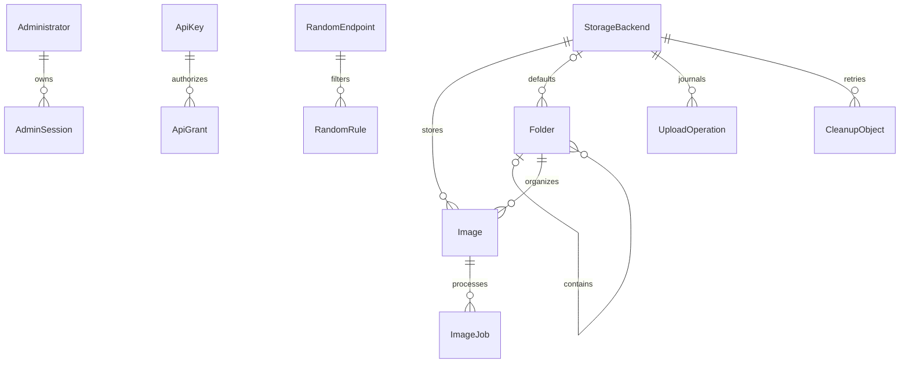
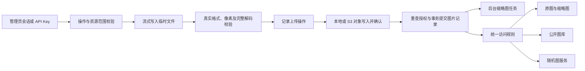

# XHImg 架构与实现

## 范围与参考项目

独立的单管理员系统，无匿名上传、公开注册或多租户。P0 完成授权上传、文件夹、本地/S3、直链、缩略图、API Key、随机图服务、公共图库及后台；P1 增加处理、续传和 AI。存储迁移后置。

EasyImg 的 Nuxt/NeDB/本地文件架构适合轻量个人使用，其图像处理与上传流程具有参考价值，但不直接继承其数据库、私有上传模型或目录扫描随机接口。PixelPunk 的文件夹、服务层与存储适配器展示了完整平台的模块边界，但 Go/GORM 与本项目 TypeScript/SQLite 路线不同，且其根许可证为非商业授权；不复制源代码或素材。两者仅作功能与结构参考，具体声明见 THIRD_PARTY_NOTICES.md。

## 工程与模块边界

```text
XHImg/
  apps/server/
    migrations/       版本化 SQL
    src/
      app.ts          插件、安全钩子、路由装配与生命周期
      db.ts           SQLite/Drizzle、迁移和事务
      security.ts     密码、加密、签名、范围判定和限流
      auth.ts         安装、管理员会话、API Key
      resources.ts    文件夹、图片管理、存储设置和公共查询
      uploads.ts      流式上传和授权图片传输
      storage.ts      本地/S3 统一对象接口
      random.ts       来源规则、候选集合和三种响应
      jobs.ts         缩略图、彻底删除和残留清理
      openapi.ts      外部接口输入与错误契约
    test/             真实数据库/对象测试、S3 HTTP 夹具、规模检查
  apps/web/src/       React 页面、Radix 组件、主题和 API 客户端
  packages/shared/    前后端共用接口类型
  tests/              隔离服务器与 Playwright 用户流程
  docs/               架构、API、运维与验证记录
```

后端单进程提供 API 和编译后的页面，部署为单容器。不引入 Redis，不允许多个实例共享数据目录。SQLite 使用 WAL、外键、事务和索引；Drizzle 管理设置查询，复杂树关系及资源权限使用参数化 SQL。

## 数据关系



`sessions` 对应单一管理员，会话只存 token 摘要。`settings` 保存站点配置、加密AI配置和未安装时的令牌摘要。随机服务的 calls/successes/failures/last_called 保存基本统计，不引入逐请求分析表。P1 的 upload_sessions 持久化续传与管线状态，jobs.payload 保存处理策略、版本及归属快照。

## 权限与数据流



- 新建资源默认私有。任意祖先私有，图片最终私有；自身权限不会被文件夹修改覆盖。
- 文件夹移动防循环；权限变化、移动、删除恢复均更新有效权限与访问版本，失效候选缓存。
- API 操作权限与多条资源范围共同生效，文件夹默认不含后代。私有读取需 read、private:read 和来源文件夹授权。
- 原图、缩略图、列表和随机图共享判权。公开服务始终只选公开图片；服务 ID 不是访问凭证。
- 私有签名限定资源、原图/缩略图、权限版本、签发者与可选服务，默认五分钟；每次读取重新验证当前会话/Key、权限与来源。
- 所有对象通过后端传输；私有 S3 源地址不发给客户端。公开图片 no-cache、私有图片与随机响应 no-store，授权先于 304 条件处理。

随机候选从已过滤的数据库 ID 集合均匀选择，缓存不超过 16MiB 估算容量、20 个集合；返回前重新授权，不扫描上传目录，不使用全表随机排序。允许连续重复，缺失对象最多三次重选，供应商故障直接 503。

## 可靠性

上传对象写入与数据库提交用持久化操作记录衔接，异常退出恢复 abandoned 操作并回收孤立对象。缩略图失败不丢失原图，任务恢复 running 状态，最多五次自动重试。彻底删除先标记 purging，删除实际对象后才删记录。连接配置仍被图片或未完成操作引用时禁止更换。

上传每次一个文件，最多两个并发，默认100MB/4000万像素；处理与缩略图共享 CPU 串行门，缩略图最长边640px，不放大。处理默认关闭，仅 JPG/PNG/WebP，拒绝动画。

## P1 管线与状态

`pipeline.ts` 为 multipart 与续传统一执行校验、存储和数据库提交。`policies.ts` 逐字段解析策略并串行图片解码；`processing.ts` 将原图或保留源转换为新对象，提交前复核内容版本及授权。独立 source 引用与当前 object 引用去重统计；旧版本在成功事务后清理。content_version 控制处理，organization_version 控制归档；access_version 控制链接和缓存失效。

`resumable.ts` 在 @tus/file-store 外增加分片 SHA-256 暂存验证层，以 SQLite configstore 和确认偏移恢复，完成后只排入 finalize 任务，204 不意味着发布完成。校验后仍通过统一 pipeline。浏览器 Worker 增量哈希，IndexedDB 只保存恢复元数据。

`organization.ts` 使用加密设置、实时候选范围及小预览调用兼容视觉接口。模型只能返回候选 ID 或 null；提交时再次校验当前授权、候选资格、图片删除及版本状态。新图 publication_hold 在所有非管理员访问、列表和随机候选统一过滤；未匹配回私有未分类。既有图片重分类不暂停当前访问。AI 单并发队列与 CPU 队列分开，等待网络不阻塞删除。

## 页面与接口

公共路由：`/`、`/gallery`、`/docs`、`/login`、`/setup`。后台：`/admin`、`/admin/services`、`/admin/folders`、`/admin/trash`、`/admin/settings`。文件夹工作区提供图片/API/权限/存储/设置标签。

系统字体、灰白底色、蓝色操作强调、浅深主题与响应式布局；Radix Dialog 提供焦点管理，表单使用明确标签，尊重减少动态效果。不展示 P1 空功能入口。

首页结构按用户提供的参考图调整：全宽图片横幅、居中品牌与介绍、“图库预览/API 文档”双入口，下方直接展示随机图服务卡片。横幅只从公开图库读取缩略图，无图或加载失败时使用默认背景。服务名称叠加在预览图上，正文提供 API 地址复制、描述、来源与文档；点击图片刷新随机预览。桌面三列、平板两列、手机单列。

外部接口与完整管理清单见 [api.md](api.md)，机器可读契约由 `/api/v1/openapi.json` 提供。部署、备份和升级规则见 [operations.md](operations.md)，实际验证结果见 [validation.md](validation.md)。
